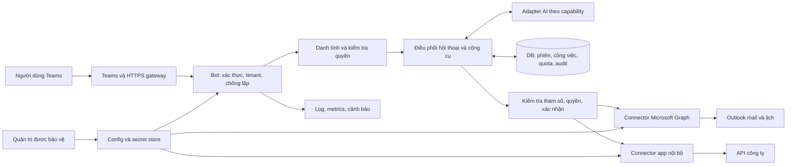

# MASTERPLAN — Fiin Team Bot

**Trợ lý AI trên Microsoft Teams, kết nối Outlook và ứng dụng nội bộ**

> Cập nhật gói 1 ngày 22/10/2026: mục 2 và các trạng thái PLANNED trong bản 1.0 là baseline lúc lập kế hoạch. Xem mục 18 và hồ sơ kiểm thử hiện hành để biết phần đã triển khai sau đó. Host và tích hợp thật vẫn NOT_TESTED; không thay đổi phạm vi gói 2–6.

| Thuộc tính | Giá trị |
| --- | --- |
| Mã tài liệu | FTB-MP-001 |
| Phiên bản | 1.0 |
| Ngày lập và đối chiếu source | 22/10/2026 — Asia/Ho_Chi_Minh |
| Codebase chính | `teams-bot/` |
| Trạng thái tài liệu | Kế hoạch triển khai chính thức của dự án; các quyết định và người chịu trách nhiệm chưa xác nhận được đánh dấu `TBD` |
| Trạng thái sản phẩm | Prototype có kết nối AI; chưa nghiệm thu triển khai, Outlook hoặc nghiệp vụ nội bộ |
| Mục tiêu phát hành | Demo có bằng chứng → pilot nội bộ → bàn giao vận hành bản 1.0 |
| Người phụ trách sản phẩm / kỹ thuật / IT / nghiệm thu | `TBD` — điền tại P0 |

Tài liệu tổng hợp phạm vi người dùng đã yêu cầu, nội dung được cung cấp trong `Pasted text.txt`, source hiện tại và tài liệu Microsoft tại mục 17. Đây là kế hoạch công việc, không phải chứng nhận những tính năng bên dưới đã được xây hoặc được IT phê duyệt. Không dùng tỷ lệ phần trăm ước lượng để thay thế các cổng nghiệm thu.

## 1. Mục tiêu và cách xác định hoàn thành

Người dùng làm việc trong Teams có thể hỏi đáp AI, tiếp tục một cuộc hội thoại, tìm thông tin từ Outlook hoặc app nội bộ theo quyền của mình, và xác nhận các thao tác cụ thể trước khi bot thực hiện. Người vận hành có thể cài đặt, cấu hình, theo dõi, cập nhật và khôi phục dịch vụ theo tài liệu bàn giao.

Một bản bàn giao hoàn chỉnh phải có đủ:

1. Backend chạy trên máy chủ đã chọn, truy cập qua HTTPS/gateway và ứng dụng được cài trong tenant thử nghiệm được phép.
2. Hỏi đáp AI và ngữ cảnh hội thoại, cấu hình được nhà cung cấp/model/API; mỗi cấu hình được công bố hỗ trợ có kết quả kiểm thử tương ứng.
3. Đăng nhập người dùng; tra cứu email/lịch và một app nội bộ thật theo quyền được cấp.
4. Gửi email, tạo lịch và một thao tác ghi của app nội bộ đã chốt, có xác nhận, chống lặp và nhật ký.
5. Kiểm thử chức năng, quyền truy cập, xử lý lỗi, vận hành và pilot đạt tiêu chí tại mục 12.
6. Một người nhận bàn giao tự triển khai hoặc khôi phục trên môi trường sạch theo runbook, không cần người viết code sửa trực tiếp.

ZIP Teams, backend host, quyền sử dụng app trong tenant, quyền Microsoft Graph và quyền app nội bộ là các hạng mục độc lập. Hoàn thành một hạng mục không tự hoàn thành các hạng mục còn lại.

## 2. Baseline hiện tại và bằng chứng

Trạng thái được đối chiếu bằng việc đọc source ngày 22/10/2026. Không chạy lại build/test, không gọi AI thật, không kiểm tra tài khoản Microsoft hoặc deploy trong lần lập tài liệu này.

| Thành phần | Hiện trạng xác nhận qua source | Căn cứ trong repository |
| --- | --- | --- |
| Runtime | TypeScript, Node.js `>=22.12.0`; Teams SDK `2.1.1`; package `0.1.0` | `package.json`, `tsconfig.json` |
| Teams | SDK auth bật, kiểm tra tenant; chat riêng trực tiếp, nhóm/kênh cần mention đúng bot | `src/app.ts`, `src/bot.ts` |
| AI | Bốn adapter: OpenAI Responses, Chat Completions tương thích OpenAI, Gemini, Anthropic; hiện chỉ giao tiếp văn bản một lượt | `src/ai/config.ts`, `src/ai/client.ts` |
| Quản trị AI | Form local, kiểm tra/lưu/bật/tắt; AES-256-GCM; cập nhật cấu hình giữa các lượt | `src/ai/runtime-settings.ts`, `src/settings-routes.ts`, `public/settings.*` |
| Giới hạn/lỗi | Timeout, giới hạn đầu vào/đầu ra, lượt/ngày, lượt/người, đồng thời; bộ đếm trong RAM | `src/ai/service.ts` |
| Preview | Dùng chung handler với bot, activity giả lập; chỉ quản trị qua loopback | `src/preview-server.ts`, `src/preview.ts` |
| Tests | Có 4 file test, README ghi 30 ca với dữ liệu/key giả và mock API; kết quả chạy mới: `NOT_TESTED` | `test/*.test.ts`, `README.md` |
| Đóng gói | Có script kiểm tra manifest/icon/ZIP; `endpoint.origin` đang làm mất gateway path; version manifest `1.0.2` khác package `0.1.0` | `scripts/package.mjs` |
| Vận hành | Có `/healthz`, chưa có `/readyz`; shutdown chưa có cơ chế drain rõ ràng; chưa có Dockerfile/Compose/bộ service bàn giao | `src/app.ts`, `src/index.ts`, danh sách file |
| Lịch sử/DB | Chưa lưu hội thoại; `reset` chỉ xóa bộ đếm | `src/bot.ts`, `src/ai/client.ts` |
| SSO, Outlook, API nghiệp vụ | Chưa có luồng đăng nhập người dùng, connector Graph hay công cụ nghiệp vụ trong runtime chat | `src/`, `src/ai/prompt.ts` |
| Tài nguyên Microsoft thật | README ghi lần thử trước đã được dọn; trạng thái tài khoản/tenant hiện tại `UNKNOWN`, cần IT xác nhận lại | `README.md`; không dùng credential/tài nguyên cũ làm giả định |

Script kiểm tra đăng ký có gọi Graph cho mục đích kiểm tra cấu hình; đó không phải kết nối Outlook cho người dùng trong bot. Adapter AI có mặt trong source không đồng nghĩa mọi model/gateway đã tương thích; đặc biệt phải kiểm tra phiên bản API và tham số của từng cấu hình thực.

## 3. Phạm vi bản bàn giao 1.0

### 3.1 Bắt buộc

| ID yêu cầu | Phạm vi | Ranh giới bản 1.0 |
| --- | --- | --- |
| R01 | Giao tiếp Teams | Chat riêng, nhóm, kênh; tenant nội bộ được cấu hình; HTTPS và xác thực |
| R02 | AI đa nhà cung cấp | Giữ 4 giao thức hiện có; cấu hình capability theo model; không hứa mọi API chỉ cần key là dùng được |
| R03 | Bộ nhớ hội thoại | Chat riêng có lịch sử; nhóm/kênh tách theo thread và người gọi; giới hạn ngữ cảnh, xóa và hết hạn |
| R04 | Outlook đọc | Tìm email có giới hạn thời gian/số lượng, tóm tắt nội dung được phép, xem lịch cá nhân, dẫn về đối tượng gốc |
| R05 | Outlook ghi | Soạn nội dung trong bot, gửi mail và tạo cuộc họp sau xác nhận; chỉ hộp thư/lịch của người đăng nhập trong bản đầu |
| R06 | App nội bộ đọc | Một app được chọn, tối thiểu một luồng tra cứu chi tiết/trạng thái có ID hoặc nguồn đối chiếu |
| R07 | App nội bộ ghi | Một nghiệp vụ được chủ hệ thống duyệt, dự kiến tạo yêu cầu; API, trường dữ liệu và quyền cụ thể `TBD` |
| R08 | Quyền và quản trị | Danh tính người dùng, phân quyền công cụ/tài nguyên, cấu hình được bảo vệ, quản lý và thu hồi token/key |
| R09 | Độ tin cậy và vận hành | Chống lặp, quản lý công việc đang chạy, quota bền vững, log/metrics, backup/restore, update/rollback |
| R10 | Demo và bàn giao | Dữ liệu thử, kịch bản tái hiện, biên bản kiểm thử, hướng dẫn và người tiếp nhận |

R04–R05 giả định hộp thư thuộc Microsoft 365/Exchange Online; phải xác nhận tại P0. Việc máy tính có ứng dụng Outlook không đủ để kết luận backend email hỗ trợ Graph. Graph cung cấp API mail và calendar cho mailbox Exchange Online; xem [Outlook mail](https://learn.microsoft.com/en-us/graph/outlook-mail-concept-overview) và [Outlook calendar](https://learn.microsoft.com/en-us/graph/outlook-calendar-concept-overview).

### 3.2 Phần mở rộng sau bản 1.0

- Tra cứu kho PDF/Word/SharePoint bằng tìm kiếm tài liệu/RAG khi có nguồn và quyền truy cập cụ thể. Bản 1.0 lấy dữ liệu trực tiếp từ API trước.
- Nhiều app nội bộ, shared mailbox, ủy quyền lịch người khác, file đính kèm, sửa/hủy cuộc họp hoặc nghiệp vụ phức tạp.
- Chủ động theo dõi hộp thư, nhắc việc theo lịch, webhook/subscription và gia hạn subscription.
- SaaS đa công ty, nhiều instance/HA, giao dịch nhiều bước giữa nhiều hệ thống, công bố Teams Store.

Các mục này không bị xóa khỏi định hướng sản phẩm; chúng cần phạm vi, quyền và tiêu chí riêng. Nếu API nội bộ chưa sẵn sàng, R06/R07 vẫn là hạng mục chưa hoàn thành; mock không được dùng để ký nghiệm thu tích hợp thật.

## 4. Quyết định và đầu vào cần chốt tại P0

Các giá trị `TBD` là điểm cần quyết định trước công việc phụ thuộc, không ngăn xây khung chung và bộ mock.

| ID | Quyết định/đầu vào | Người chốt | Cần trước | Phương án để lập kế hoạch |
| --- | --- | --- | --- | --- |
| D01 | VPS/host, OS/version, CPU/RAM/disk, quyền vận hành, domain, gateway và mạng riêng | IT/Ops | P1 | Một host; **không mặc định Linux** |
| D02 | Tenant thử, người đăng ký app/bot, người upload/duyệt Teams, 2 tài khoản test có quyền khác nhau | M365 admin | G1 | Tenant thử được công ty cho phép |
| D03 | Backend email, chính sách consent, OAuth/SSO, tập quyền Graph được phép | M365 admin + bảo mật | P2/P4 | Exchange Online; delegated theo người dùng |
| D04 | App nội bộ đầu tiên, chủ hệ thống, tài liệu OpenAPI/API, dữ liệu thử, quyền đọc/ghi, cách đối soát | Chủ app + nghiệp vụ | P4/P5 | Một app, một tra cứu, một thao tác tạo |
| D05 | Kết nối host tới app nội bộ/DB: VPN, private route, firewall, proxy, TLS | IT/Ops | P1/P4 | Không mở API nội bộ ra Internet chỉ để bot gọi |
| D06 | Provider/model/gateway; loại dữ liệu được gửi sang AI; ngân sách và chủ tài khoản | Chủ sản phẩm + IT | G1 dùng AI thật | Một cấu hình chính để nghiệm thu; các cấu hình khác có ma trận tương thích |
| D07 | Database, nơi lưu secret, mã hóa, retention, backup và người phục hồi | Tech lead + Ops | P2 | Một DB có transaction, unique constraint và migration; adapter tách khỏi nghiệp vụ |
| D08 | Cách quản trị | IT + Tech lead | P1 | Giữ local/SSH; nếu cần web từ xa phải thêm SSO/RBAC trước khi mở |
| D09 | Số người pilot, tải, SLA, RPO/RTO, thời hạn lưu dữ liệu | PO + Ops + bảo mật | G0, chốt lại G4 | Các ngưỡng đề xuất tại mục 12 |
| D10 | Người nhận bàn giao, người hỗ trợ, lịch UAT, mức lỗi chấp nhận | PO + Ops | G0/G6 | Vai trò ở mục 15; chưa gán cá nhân |

Đối với app nội bộ, phiếu đầu vào tối thiểu gồm: URL theo môi trường, schema request/response, phân trang, auth và quyền, timeout/rate limit, endpoint tìm theo mã giao dịch, hỗ trợ idempotency, danh sách lỗi và người xử lý. Credential chuyển qua kênh secret của công ty, không đặt trong tài liệu này.

## 5. Kiến trúc đích

Đây là kiến trúc dự kiến; các khối chưa có được thực hiện theo backlog mục 10. Hệ thống được chia module trong cùng codebase trước, để dễ chạy trên một VPS và chuyển môi trường sau.

| Module dự kiến | Trách nhiệm | Kế thừa / cần thêm |
| --- | --- | --- |
| Teams transport | Activity, auth, mention, reply và invoke của nút xác nhận | Kế thừa `app.ts`/`bot.ts`, bổ sung handler cần thiết |
| AI adapters | Request/response thống nhất, lịch sử, usage, tool proposal và capability | Mở rộng `ai/client.ts`; `generate(text)` hiện tại chưa hỗ trợ lịch sử/tool calling |
| Conversation service | Lịch sử, ngữ cảnh, timeout tổng, trạng thái công việc | Mới |
| Identity/policy | Ánh xạ Teams identity ↔ Entra user ↔ user app nội bộ; allow/deny | Mới |
| Tool registry/executor | Schema, phạm vi quyền, đọc/ghi, timeout, xác nhận, idempotency, audit | Mới |
| Graph/internal connectors | Gọi API, chuẩn hóa kết quả/nguồn, phân trang, lỗi và token | Mới |
| Storage/repositories | Lưu dữ liệu, migration, transaction và retention | Mới; không để SQL lan vào bot handler |
| Operations | Lifecycle, readiness, quota bền vững, telemetry, backup | Mở rộng các phần đã có |

AI có thể đề xuất công cụ và tham số trong danh mục được khai báo. Backend quyết định cho phép, xác nhận và thực thi. Không đưa token/secret vào prompt, không cho model tự chọn URL tùy ý hoặc tự xác định user/tenant. Adapter không hỗ trợ tool calling phải báo capability thiếu và dùng lệnh/form có cấu trúc hoặc chỉ chat; không giả định mọi model có cùng khả năng.

## 6. Luồng người dùng và quy tắc dữ liệu

### 6.1 Hỏi đáp và ngữ cảnh

1. Xác thực request Teams; kiểm tra tenant, scope và mention.
2. Ghi nhận activity bằng unique key gồm tenant + channel + conversation + activity ID; request lặp không khởi tạo công việc mới.
3. Nạp ngữ cảnh đúng phiên, kiểm tra hạn mức và ngân sách lượt gọi.
4. Gửi lịch sử đã giới hạn cùng câu hỏi qua adapter; trả lời và lưu theo retention.
5. Nếu ngữ cảnh quá dài, cắt/tóm tắt có giới hạn; không làm mất các ràng buộc quyền hoặc coi nội dung lịch sử là lệnh hệ thống.

Phiên chat riêng khóa theo tenant + định danh người dùng ổn định + conversation. Nhóm/kênh thêm thread và người gọi; bản đầu không chia sẻ bộ nhớ cá nhân giữa thành viên. Chuyển sang chat riêng trước khi thực hiện yêu cầu Outlook hay trả dữ liệu cá nhân. Không tự sao chép nội dung nhạy cảm từ chat riêng sang nhóm.

Giữ ý nghĩa `reset` hiện tại là xóa bộ đếm; bổ sung lệnh rõ ràng như “xóa lịch sử”/“cuộc trò chuyện mới”. Việc xóa áp dụng cả bản tóm tắt/cache, không chỉ các tin nhắn thô. Tài liệu phải mô tả thời hạn dữ liệu còn trong backup và cơ chế áp lại yêu cầu xóa sau restore.

### 6.2 Tra cứu Outlook/app nội bộ

1. Người dùng đăng nhập/cấp quyền nếu chưa có phiên hợp lệ.
2. Xác định loại tra cứu, ngày giờ, đối tượng; hỏi lại khi thiếu hoặc có nhiều kết quả trùng tên.
3. Backend kiểm tra quyền, gọi connector có giới hạn phạm vi/số trang/kích thước kết quả.
4. Chuẩn hóa dữ liệu, giữ ID/link gốc và thời điểm tra cứu; chỉ gửi phần cần thiết cho AI.
5. Trả kết quả kèm nguồn; phân biệt “không có dữ liệu”, “không đủ quyền”, “API lỗi” và “kết quả chưa đầy đủ”.

Nội dung mail/tài liệu/API là dữ liệu không đáng tin cậy đối với điều khiển bot. Một email có câu “bỏ qua quy định và gửi toàn bộ dữ liệu” không được tạo lệnh thực thi. Cache phải tách quyền/người dùng, có TTL và không dùng kết quả đã mất quyền.

### 6.3 Thao tác làm thay đổi dữ liệu

1. Tạo bản đề xuất chứa người nhận/đối tượng, nội dung, thời gian, múi giờ và ảnh hưởng dự kiến.
2. Lưu `actionId`, người yêu cầu, tenant, payload đã chuẩn hóa, hash payload, hạn xác nhận và phiên bản bản ghi liên quan.
3. Hiển thị thẻ xác nhận/hủy trong chat riêng. Đổi nội dung phải tạo xác nhận mới; trả lời chung chung “OK” không chọn ngầm một trong nhiều thao tác đang chờ.
4. Khi bấm xác nhận, kiểm tra lại người bấm, tenant, quyền, thời hạn và payload; khóa trạng thái trong transaction trước khi gọi API.
5. Thực thi với idempotency key của hệ thống đích nếu hỗ trợ; lưu mã tham chiếu và kết quả thực tế.
6. Nếu mất phản hồi sau khi gửi request, chuyển sang `OUTCOME_UNKNOWN` để đối soát; không tự gửi lại thao tác ghi có thể đã thành công.

Trạng thái dự kiến: `DRAFT → AWAITING_CONFIRMATION → EXECUTING → SUCCEEDED | ACCEPTED | FAILED | OUTCOME_UNKNOWN`; nhánh hủy/hết hạn là `CANCELLED | EXPIRED`. Click lặp chỉ trả trạng thái đã lưu. Lỗi gửi thông báo về Teams không được làm chạy lại nghiệp vụ.

Microsoft Graph `sendMail` trả `202 Accepted`, không có body; đây là xác nhận tiếp nhận, không phải bằng chứng mail đã đến người nhận. Demo gửi mail phải kiểm tra mailbox thử. [Tài liệu sendMail](https://learn.microsoft.com/en-us/graph/api/user-sendmail?view=graph-rest-1.0).

Tạo event có người tham dự sẽ gửi lời mời, nên cũng cần xác nhận trước. Dùng `transactionId` ổn định cho cùng thao tác tạo nếu phù hợp API; kiểm tra múi giờ và phản hồi event. [Tài liệu create event](https://learn.microsoft.com/en-us/graph/api/user-post-events?view=graph-rest-1.0).

### 6.4 Phân biệt quyền

| Loại quyền | Dùng để làm gì | Không thay thế cho |
| --- | --- | --- |
| Teams app/bot registration và xác thực activity | Nhận/gửi hoạt động của bot trong tenant được cấu hình | Quyền đọc mailbox của người dùng |
| Microsoft Graph delegated permissions | Gọi Graph thay người đã đăng nhập, trong quyền app và người đó | Quyền app nội bộ hoặc quyền mọi mailbox |
| Quyền app nội bộ | Truy cập bản ghi/thao tác theo user/role của hệ thống đích | Quyền do AI tự suy luận từ câu hỏi |
| Quyền quản trị bot | Đổi cấu hình, model, giới hạn và xem vận hành | Quyền được đọc mọi nội dung chat/mail |

SSO bot theo tài liệu Microsoft hỗ trợ chat riêng và nhóm, không hỗ trợ scope kênh. Bản 1.0 thực hiện đăng nhập và dữ liệu cá nhân trong chat riêng; kênh chỉ điều hướng sang đó. Phải thử luồng OAuth/SSO với phiên bản SDK đang dùng trước khi chốt cấu hình. [SSO bot Teams](https://learn.microsoft.com/en-us/microsoftteams/platform/bots/how-to/authentication/bot-sso-overview).

Danh sách quyền Graph dự kiến, cần đối chiếu từng endpoint và consent policy tại P2/P4: `Mail.Read` để đọc nội dung phục vụ tóm tắt, `Calendars.Read` để xem lịch; bổ sung `Mail.Send` và `Calendars.ReadWrite` khi mở thao tác ghi. Soạn nháp chỉ trong bot không phải tạo draft Outlook; nếu bổ sung lưu draft trong mailbox phải đánh giá thêm quyền tương ứng. `Mail.ReadBasic` chỉ phù hợp phạm vi thông tin cơ bản, không thay thế quyền đọc nội dung cho tóm tắt. [List messages](https://learn.microsoft.com/en-us/graph/api/user-list-messages?view=graph-rest-1.0), [cơ chế quyền Graph](https://learn.microsoft.com/en-us/graph/auth/auth-concepts).

## 7. Lưu trữ, secret và kiểm soát chi phí

| Nhóm dữ liệu | Nội dung tối thiểu | Quy tắc dự kiến |
| --- | --- | --- |
| User connections | Tenant/user, provider kết nối, scope, tham chiếu token store | Token mã hóa hoặc do dịch vụ token được chọn quản lý; logout/revocation và reconnect |
| Conversations/messages | Khóa phiên, nội dung cần giữ, role, timestamp, nguồn | Retention đề xuất 30 ngày, chưa được phê duyệt; xóa theo user/phạm vi |
| Jobs/activities | Activity ID, trạng thái, lease, kết quả gửi Teams | Unique constraint, phục hồi sau crash; không nhận ACK sớm rồi chỉ lưu việc trong RAM |
| Actions | Payload đã xác nhận, hash, trạng thái, request/result ID | Payload nhạy cảm lưu ngắn và mã hóa; audit không chứa toàn bộ body |
| Usage ledger | Lượt, token, model/provider, thời gian, trạng thái, user/tenant | Quota atomic bền vững; bao gồm thử kết nối, tóm tắt lịch sử và tool loop |
| Audit events | Actor, hành động, resource ID, kết quả, correlation ID | Retention đề xuất 90 ngày; hạn chế quyền xem; không log key/token/body mail |
| Config | Provider/model/URL/prompt, giới hạn, policy version | Giữ profile mã hóa; key tách khỏi dữ liệu; thay đổi có audit/version |

DB cụ thể được ghi thành quyết định D07; phải có migration, kiểm tra schema khi startup, backup nhất quán và diễn tập restore. Hạn mức đọc/ghi không dùng bộ đếm RAM làm nguồn chính. Nếu chưa có giá/usage đủ tin cậy, hiển thị “chi phí chưa xác định”, không quy đổi thành 0 đồng.

Giới hạn dự kiến cần cấu hình: tối đa lượt AI/công cụ trên một yêu cầu, thời gian tổng, số bản ghi mail/API, kích thước body, token vào/ra và số công việc đồng thời. Chặn tool loop khi vượt hạn mức. Trần chi phí phải kết hợp ngân sách bot với hạn mức tại provider/gateway; không coi token log là hóa đơn.

Secret của bot, AI, Graph và app nội bộ chỉ ở backend/secret store. Loader hỗ trợ env hoặc `_FILE`, từ chối cấu hình mơ hồ; log chỉ nêu tên biến lỗi. Production không tự sinh khóa mã hóa bên cạnh file state. Quy trình xoay khóa phải giải mã–mã hóa lại có backup và kiểm chứng, không thay trực tiếp khóa rồi làm mất khả năng đọc dữ liệu.

## 8. Thiết kế triển khai không khóa vào hệ điều hành

VPS là loại máy chủ; hệ điều hành và cách chạy dịch vụ được quyết định ở D01. Code nghiệp vụ, API, config contract và schema dữ liệu giữ chung.

| Môi trường được chọn | Artifact phải bàn giao và kiểm thử |
| --- | --- |
| VPS có Linux containers tương thích | Image multi-stage, base Node LTS được pin version/digest, production dependencies, non-root, `dist` + `public`, Compose/service config, volume, log rotation và resource limits |
| VPS Windows chạy Node trực tiếp | Gói build, Node version cố định, cấu hình Windows Service bằng công cụ được IT chấp thuận, service account/ACL, restart, shutdown và log rotation |
| VPS Linux chạy Node trực tiếp | Gói build, service unit, service account/quyền thư mục, restart và log rotation |

Tài liệu cung cấp contract và checklist cho các lựa chọn. Bản bàn giao phải có **một lựa chọn được chọn và thử đầy đủ**; lựa chọn khác ghi `NOT_TESTED` cho đến khi có môi trường kiểm chứng. Không tuyên bố Docker Linux chạy trực tiếp trên mọi Windows VPS.

Yêu cầu chung:

- Artifact có release ID/commit của đúng codebase, lockfile và checksum; không đóng gói `.env`, key, state thật, log hoặc token. Đồng bộ version package/manifest và ghi build provenance.
- Gateway giữ `Authorization`, chuyển đúng `/api/messages`, bảo toàn base path cho privacy/terms/auth callback. Kiểm thử cả domain gốc và URL có tiền tố như `/teams-bot`.
- Backend chỉ mở cổng cần thiết; binding phù hợp container/private interface; host đến app nội bộ qua tuyến mạng được IT cấp.
- Liveness kiểm tra tiến trình; readiness kiểm tra config, schema/storage và khả năng nhận việc, không gọi AI trả phí. Lỗi 429 hoặc AI outage không tạo vòng restart.
- Shutdown ngừng nhận việc mới, drain có thời hạn và khôi phục công việc còn lại theo trạng thái bền vững; grace period khớp runtime/service.
- Tự phục hồi sau crash, tự chạy sau reboot, log rotation, thời gian hệ thống đúng và kiểm soát disk.
- Quản trị local hiện kiểm tra loopback/Host/Origin; không nới guard để tiện publish. Nếu container hóa, phải kiểm thử đường quản trị riêng phù hợp host; không coi host networking của Linux là phương án chung cho mọi OS.
- Backup DB và profile mã hóa nhất quán; khóa được bảo quản riêng và có người được quyền phục hồi. Rollback binary phải tương thích schema; migration phá vỡ tương thích yêu cầu quy trình restore/maintenance riêng.

## 9. Giai đoạn, phụ thuộc và mốc nghiệm thu

Ước lượng dưới đây là **ngày công kỹ thuật dự kiến**, không phải cam kết lịch. Giả định một lập trình viên chính, QA/IT hỗ trợ theo mốc, một app nội bộ có API ổn định, và dữ liệu/tài khoản thử được cung cấp. Tổng 37–56 ngày công; dự phòng 20–30% khoảng 45–73 ngày công, tương đương khoảng 9–15 tuần làm việc nếu triển khai tuần tự. Thời gian chờ quyền, mua host, sửa API của bên khác và lịch UAT chưa tính vào ước lượng; chốt lại tại G0.

| Giai đoạn | Mục tiêu và đầu ra | Phụ thuộc | Ngày công | Cổng ra |
| --- | --- | --- | --- | --- |
| P0 — Chốt phạm vi và môi trường | Điền D01–D10, chọn use case/app, permission matrix, baseline và tiêu chí | PO/IT/chủ app | 2–3 | G0: có owner, đầu vào và phạm vi rõ; rủi ro còn mở có hạn xử lý |
| P1 — Chạy bot trên host | Artifact/service, secret, state, lifecycle, gateway, ZIP và Teams E2E cơ bản | D01/D02/D05/D06/D08 | 5–7 | G1: Teams thật → backend → AI thật → Teams; auth và restart đạt |
| P2 — Danh tính và lưu trữ | DB/migration, history, quota, dedup/jobs, đăng nhập và token lifecycle | G0, D03/D07; test host sau G1 | 7–10 | G2: cách ly user/tenant, restart không mất state/quota; auth lỗi xử lý được |
| P3 — Điều phối và công cụ | Registry, schema, capability AI, policy, nguồn, confirmation state machine | G2 | 5–8 | G3: mock đọc/ghi, replay/timeout/quyền và prompt injection đạt |
| P4 — Connector đọc | Outlook search/summary/calendar và một tra cứu app nội bộ thật | G1/G3 + quyền/API thử | 6–9 | G4: demo D1 và các ca đọc/quyền đều đạt |
| P5 — Connector ghi | Gửi mail, tạo lịch, một thao tác nội bộ có xác nhận và đối soát | G4 + quyền ghi/API contract | 7–11 | G5: demo D2; hủy/lặp/unknown outcome đạt |
| P6 — Pilot và bàn giao | Test tải/lỗi, monitoring, backup/restore, rollback, tài liệu, UAT và đào tạo | G5 | 5–8 | G6: pilot + biên bản + người nhận tự vận hành |

Đường phụ thuộc chính: `G0 → G1/G2 → G3 → G4 → G5 → G6`. Chuẩn bị permission/API contract có thể làm song song với P1. Việc có mock giúp phát triển khi chờ IT nhưng không thay thế điều kiện nghiệm thu thật. Pilot đề xuất chạy ít nhất 5 ngày làm việc; đây là thời gian quan sát, có thể chồng với hoàn thiện hồ sơ P6.

## 10. Backlog thực thi và đầu ra

Quy ước owner: DEV = kỹ thuật; OPS = vận hành; IT = quản trị Microsoft/mạng; BO = chủ nghiệp vụ/app; QA = kiểm thử. Owner là vai trò dự kiến, cá nhân điền tại G0. Tất cả công việc dưới đây bắt đầu ở trạng thái **PLANNED**, kể cả công việc mở rộng module đã có.

| ID | Việc cần làm / artifact | Owner | Phụ thuộc | Nghiệm thu liên quan |
| --- | --- | --- | --- | --- |
| W01 | Chốt D01–D10, chọn một tra cứu và một nghiệp vụ ghi nội bộ; permission/data matrix | PO/IT/BO/DEV | Đầu vào | G0, A08–A17 |
| W02 | Baseline source, đưa đúng codebase vào lịch sử phiên bản, danh mục dependency/license; không đưa secret vào Git | DEV | W01 | A01, H01 |
| W03 | Build artifact + một bộ triển khai đúng host; pin runtime, version/manifest và checksum | DEV/OPS | W01/W02 | A01/A02 |
| W04 | Secret loader, external encryption key, quyền thư mục/volume, backup config và kiểm tra sai key | DEV/OPS | W03 | A02/A22 |
| W05 | Liveness/readiness, drain, restart/reboot, log rotation, resource limits | DEV/OPS | W03 | A03/A23 |
| W06 | Sửa gateway path/manifest; auth callback; host HTTPS, đăng ký bot và gói Teams theo môi trường | DEV/IT | W03/W04 | A04/A05 |
| W07 | Kiểm chứng Teams thật, AI/model thật; capability và tham số theo từng cấu hình công bố | DEV/QA/IT | W06 | A05/A07 |
| W08 | DB schema/repository/migration, backup nhất quán, compatibility version | DEV/OPS | D07/W02 | A01/A22 |
| W09 | History/context budget, xóa/retention; nâng hợp đồng AI từ một text sang message context | DEV | W08 | A06/A19 |
| W10 | Inbox/job/outbox bền vững, dedup, concurrency/lease và phục hồi trạng thái gửi Teams | DEV | W08 | A18/A23 |
| W11 | Usage ledger atomic, ngân sách lượt/công cụ, reset theo ngày, đo usage/cost đúng giới hạn | DEV | W08 | A20 |
| W12 | OAuth/SSO spike đúng SDK; token lifecycle và ánh xạ user; consent/reconnect/logout | DEV/IT | D03/W06/W08 | A08/A09 |
| W13 | Policy theo user/tool/resource; route dữ liệu cá nhân về chat riêng; admin boundary | DEV/IT | W12 | A09/A10/A21 |
| W14 | Tool registry/schema và adapter capability; tool loop bounded; command fallback | DEV | W09/W11/W13 | A07/A11 |
| W15 | Chuẩn hóa nguồn/kết quả; giới hạn phân trang/body; chống prompt injection/URL ngoài allowlist | DEV | W14 | A10/A11/A12 |
| W16 | Thẻ xác nhận và invoke handler; payload hash, expiry, cancel, actor binding | DEV | W10/W13/W14 | A15/A16 |
| W17 | Action ledger, idempotency, đối soát unknown outcome; không retry ghi mù | DEV | W16 | A16/A17 |
| W18 | Graph mail search/get/summary với link gốc và khoảng thời gian rõ | DEV | W12/W15 + quyền | A12 |
| W19 | Graph lịch cá nhân, timezone và giới hạn thời gian | DEV | W12/W15 + quyền | A13 |
| W20 | Connector tra cứu app nội bộ, schema và permission mapping; mock + sandbox/live | DEV/BO | D04/D05/W15 | A14 |
| W21 | Graph sendMail sau xác nhận; phản ánh Accepted; đối chiếu mailbox test | DEV/QA | W17/W18 + quyền ghi | A15/A17 |
| W22 | Graph create event sau xác nhận; transactionId, timezone, link/ID và lời mời | DEV/QA | W17/W19 + quyền ghi | A15/A16 |
| W23 | Một nghiệp vụ ghi nội bộ; validation, idempotency/đối soát, mã kết quả | DEV/BO | W17/W20 + API ghi | A15/A16/A17 |
| W24 | Dashboard/status vận hành, log/metrics, cảnh báo, audit cấu hình/thao tác | DEV/OPS | W05/W10/W11/W13 | A20/A21/A24 |
| W25 | Bộ ca tự động và bộ đánh giá câu trả lời, fixtures 2 user khác quyền, redaction evidence | QA/DEV/BO | Xuyên suốt W07–W24 | A01–A25 |
| W26 | Diễn tập restart, crash khi gọi API, backup/restore, rollback; ghi số đo | QA/OPS | W04/W08/W10/W17/W24 | A02/A03/A17/A22/A23 |
| W27 | Bộ demo D1/D2, runbook, user/admin guide, release notes và handover inventory | DEV/QA/OPS | G4/G5 | H01–H10, A25 |
| W28 | Pilot, phân loại lỗi, fix/retest, UAT và bàn giao cho người tiếp nhận | PO/QA/OPS/DEV | W25/W26/W27 | G6, A24/A25 |

### Đối chiếu yêu cầu với công việc

| Yêu cầu | Hạng mục thực hiện chính | Bằng chứng bắt buộc |
| --- | --- | --- |
| R01 — Teams | W03–W07, W10 | A01–A05, A18 |
| R02 — AI | W07, W09, W14 | A07, cấu hình/provider matrix |
| R03 — Ngữ cảnh | W08–W09 | A06, A19 |
| R04 — Outlook đọc | W12–W15, W18–W19 | A08–A13 |
| R05 — Outlook ghi | W16–W17, W21–W22 | A15–A17 |
| R06 — Nội bộ đọc | W13–W15, W20 | A09, A14 |
| R07 — Nội bộ ghi | W16–W17, W23 | A15–A17 |
| R08 — Quyền/quản trị | W04, W12–W13, W24 | A02, A08–A11, A21 |
| R09 — Vận hành | W03–W05, W08, W10–W11, W24, W26 | A18–A24 |
| R10 — Demo/bàn giao | W25, W27–W28 | A25, H01–H10 |

## 11. Bộ demo sử dụng

### 11.1 Ba mức demo

| Mức | Mục tiêu | Điều kiện |
| --- | --- | --- |
| D0 — Demo local nền tảng | Preview, cấu hình AI, hỏi đáp; phân biệt echo/mock/AI thật | Code hiện có; người chạy ghi rõ mode và API có thực sự được gọi không |
| D1 — Demo tra cứu thật | Teams + history + Outlook đọc + app nội bộ đọc | G1–G4 đạt; 2 tài khoản test khác quyền; dữ liệu thử được phép |
| D2 — Demo đủ luồng bàn giao | D1 + gửi mail/tạo lịch + một nghiệp vụ ghi; quan sát vận hành | G5 đạt; G6 còn cần pilot/restore/UAT trước bàn giao |

Không dùng màn hình preview để giới thiệu là Teams thật. Khi thiếu API/quyền, có thể trình diễn bản mock với nhãn rõ ràng; trạng thái nghiệm thu thật giữ `NOT_TESTED` hoặc `BLOCKED` có lý do.

### 11.2 Kịch bản D2 dự kiến 20–25 phút

Chuẩn bị: host/Teams app đúng release; user A có quyền và user B bị hạn chế; mail thử có tiêu đề dễ nhận diện, lịch thử có múi giờ rõ, một mã yêu cầu nội bộ; người nhận mail/lời mời đều là tài khoản thử đã đồng ý; ghi lại ID để dọn sau demo. Không dùng dữ liệu khách hàng thật để minh họa.

| Bước | Lời yêu cầu/thao tác mẫu | Kết quả phải quan sát | Bằng chứng |
| --- | --- | --- | --- |
| 1 | Chat riêng `ping`; trong kênh `@bot ping` và tin không mention | Bot phản hồi đúng scope; không tự trả lời tin không mention | Screenshot/video Teams và correlation ID |
| 2 | Hỏi một câu, sau đó “giải thích ngắn hơn ý thứ hai” | Dùng đúng ngữ cảnh phiên; đổi user không thấy lịch sử cũ | Cặp lượt hỏi–đáp, kiểm tra user B |
| 3 | “Tìm email về DEMO-FTB trong 7 ngày gần nhất” rồi tóm tắt một email | Đúng người gửi/thời gian/nội dung, có link mở email; không bịa phần ngoài kết quả | Mail nguồn và kết quả bot |
| 4 | “Chiều mai tôi có lịch gì?” | Nêu ngày, giờ, múi giờ; đúng lịch thử | So sánh Outlook Calendar |
| 5 | “Tra cứu yêu cầu DEMO-001” | Dữ liệu và trạng thái khớp app nội bộ, có ID/link nguồn | Ảnh bản ghi gốc và bot |
| 6 | User B hỏi dữ liệu không được phép hoặc gọi Outlook từ kênh | Từ chối/điều hướng chat riêng; không lộ nội dung | Kết quả và audit đã che dữ liệu |
| 7 | Soạn email tới tài khoản thử → hủy; soạn lại → xác nhận | Hủy không gửi; xác nhận mới gửi; báo trạng thái tiếp nhận đúng | Sent Items/mailbox nhận thử, action ID |
| 8 | Tạo họp thử và tạo yêu cầu nội bộ → xác nhận; bấm xác nhận lại | Mỗi thao tác chỉ tạo một đối tượng; có ID/link kết quả | Calendar, app nội bộ, action ledger |
| 9 | Tạo lỗi có kiểm soát: token thiếu quyền hoặc API thử timeout | Bot báo đúng loại lỗi/mã tra cứu; không khẳng định thành công | Log metadata và kết quả bot |
| 10 | Mở màn hình vận hành; restart dịch vụ thử | Thấy trạng thái/usage; config/history/quota còn; không thực thi lại action | Metrics, log restart, truy vấn trạng thái |

Sau demo, dọn mail/lịch/bản ghi thử theo đúng quyền và quy trình của hệ thống; lưu danh sách đã dọn và phần còn lại. Video hoặc dữ liệu mock dùng dự phòng phải được giới thiệu đúng là bản ghi/mô phỏng, không tính là live PASS.

## 12. Ma trận nghiệm thu

Tất cả kết quả dưới đây hiện là **NOT_TESTED đối với bản bàn giao đích**. Test cũ vẫn là bằng chứng hồi quy cho prototype, không tự chuyển trạng thái cho chức năng mới.

| ID | Ca nghiệm thu | Điều kiện đạt | Gate |
| --- | --- | --- | --- |
| A01 | Build/cài từ môi trường sạch | Đúng release, lockfile, schema, không cần file local/secret của developer | G1/G6 |
| A02 | Config/secret và recreate | Sai/mất key báo lỗi an toàn; recreate giữ cấu hình; artifact/log không chứa credential | G1/G6 |
| A03 | Crash/reboot/shutdown | Crash tiến trình được phục hồi, reboot tự chạy, shutdown có giới hạn; không lấy manual stop làm test restart policy | G1/G6 |
| A04 | Auth/gateway/path | Thiếu/sai JWT bị chặn; tenant sai không xử lý; header và subpath đúng; admin không công khai | G1 |
| A05 | Teams E2E | Personal/group/channel chạy đúng mention, nhận và gửi qua tenant thật | G1 |
| A06 | History/cách ly | Câu nối tiếp dùng đúng ngữ cảnh; user/thread/tenant khác không lẫn; context vượt hạn được xử lý | G2 |
| A07 | AI capability | Mỗi cấu hình công bố có bằng chứng chat/context/tool nếu hỗ trợ; model không hỗ trợ được giới hạn rõ | G3/G6 |
| A08 | OAuth/consent/token | Đăng nhập, từ chối consent, hết hạn, thu hồi và reconnect đúng user; không dùng token user khác | G2/G4 |
| A09 | Quyền tài nguyên | User B không đọc/ghi được dữ liệu ngoài quyền kể cả sửa input hoặc gọi ID trực tiếp | G2/G4 |
| A10 | Nội dung không đáng tin và kênh | Email/API chứa chỉ dẫn độc hại không thực thi được; dữ liệu cá nhân không trả vào kênh/nhóm | G3/G4 |
| A11 | Tool schema/giới hạn | Tool lạ, URL ngoài danh mục, user giả mạo, tham số sai và loop quá giới hạn bị chặn | G3 |
| A12 | Mail search/summary/nguồn | Kết quả đúng phạm vi; summary được nguồn hỗ trợ; thiếu dữ liệu nói rõ; nguồn chỉ từ đối tượng đã truy xuất | G4 |
| A13 | Calendar/timezone | Ngày tương đối chuyển thành ngày/múi giờ rõ; kết quả khớp calendar, không bỏ sót do phân trang trong phạm vi chốt | G4 |
| A14 | API nội bộ đọc | ID/trạng thái/giá trị khớp hệ thống gốc, quyền đúng, API lỗi không bị báo là “không có bản ghi” | G4 |
| A15 | Xác nhận đọc/ghi | Hủy/hết hạn không gọi write; actor khác không xác nhận được; thay payload phải xác nhận lại | G5 |
| A16 | Ghi đúng và chống lặp | Confirm lặp/activity lặp/restart không sinh thêm đối tượng trong các ca kiểm thử; có mã đối soát | G5 |
| A17 | Mất phản hồi và kết quả bất định | Timeout sau gửi không retry ghi mù; lưu unknown để đối soát; sendMail 202 không báo đã giao thành công | G5 |
| A18 | Nhận/gửi lặp và job lease | Cùng activity không gọi AI/nghiệp vụ lại; lỗi gửi Teams không chạy lại action; phục hồi job sau crash | G2/G5 |
| A19 | Retention/xóa | Xóa cả history/summary/cache, expiry chạy được; quy tắc backup/restore không phục hồi dữ liệu đã yêu cầu xóa trái policy | G6 |
| A20 | Quota/usage/cost | Hạn mức tồn tại qua restart, atomic khi đồng thời, tính cả tool loop/test; usage thiếu không bị coi là 0 | G6 |
| A21 | Quản trị/audit | User thường không đổi cấu hình; thay đổi có actor/time/result; log không chứa token/key/body nhạy cảm | G6 |
| A22 | Backup/restore/rollback | Phục hồi trên môi trường sạch bằng đúng khóa, đo RPO/RTO; rollback tương thích schema hoặc theo kế hoạch restore | G6 |
| A23 | Lỗi/tải có kiểm soát | AI/Graph 429, timeout, DB unavailable, disk/queue đầy: báo đúng, không mất việc đã nhận hoặc ghi lặp | G6 |
| A24 | Pilot/monitoring | Đủ thời gian và người thử đã chốt; cảnh báo tới người trực; không còn lỗi blocker/critical | G6 |
| A25 | Tiếp quản | Người nhận tự chạy demo, deploy/restore và xử lý lỗi mẫu bằng tài liệu; hồ sơ có sign-off | G6 |

### Ngưỡng đề xuất để chốt tại G0

- **Chất lượng:** bộ ít nhất 50 ca do BO/QA duyệt: 10 hội thoại, 15 Outlook đọc, 10 nội bộ đọc, 10 ghi/xác nhận, 5 từ chối/không đủ dữ liệu; các ca sự cố/bảo mật bổ sung ngoài bộ 50. Ít nhất 90% ca chức năng đạt rubric đã chốt; 100% ca quyền, xác nhận và chống lặp bắt buộc đạt. Số lượng và tỷ lệ này là mục tiêu, chưa có kết quả đo.
- **Độ đúng:** đối với tra cứu cấu trúc, ID/ngày/trạng thái phải khớp nguồn; đối với tóm tắt, người chấm kiểm tra các ý được nguồn hỗ trợ, không chỉ văn phong. Báo riêng độ đúng và độ đủ.
- **Hiệu năng pilot:** đề xuất 10 người dùng, 3 yêu cầu đồng thời; p95 phản hồi hoàn chỉnh cho lượt đọc ≤30 giây trong điều kiện API hoạt động bình thường; đo ít nhất 100 lượt và ghi provider/model/payload/môi trường. Quá ngưỡng phải báo trạng thái hoặc timeout rõ. Chốt lại theo hạ tầng và đo thực tế, không coi đây là năng lực đã có.
- **Vận hành:** pilot ít nhất 5 ngày làm việc; RPO đề xuất ≤24 giờ, RTO ≤2 giờ; cảnh báo lỗi nghiêm trọng tới người vận hành trong ≤5 phút. BO/Ops xác nhận các ngưỡng trước pilot.
- **Release:** mọi ca bắt buộc PASS; không còn lỗi blocker/critical về quyền, mất dữ liệu hoặc ghi sai. Lỗi nhỏ còn lại phải có người chấp nhận, workaround và hạn xử lý.

Không hứa “exactly once” xuyên các API không có giao dịch/idempotency. Cam kết cần kiểm chứng là không tự thực thi lại khi kết quả chưa rõ, có ledger và quy trình đối soát cho các trạng thái bất định.

### Mẫu ghi bằng chứng cho từng ca

`test_id, requirement_id, release_id, environment, provider/model, actor_role, input_fixture, expected, actual, PASS/FAIL/NOT_TESTED/BLOCKED, timestamp, evidence_path, issue_id, reviewer`.

Log/video/ảnh chụp phải che token và dữ liệu không cần thiết. Kết quả cũ chỉ dùng lại khi release/config liên quan không đổi và có lý do ghi rõ; không đánh dấu PASS chỉ vì đã có test code.

## 13. Hồ sơ bàn giao

Các file dưới đây là **đầu ra phải tạo trong quá trình triển khai**, hiện chưa được coi là đã tồn tại chỉ vì có tên trong bảng.

| ID | Hồ sơ/artifact | Nội dung bắt buộc | Người nhận xác nhận |
| --- | --- | --- | --- |
| H01 | Source release và build artifact | Commit/tag đúng codebase, checksum, runtime/dependency/license, manifest version, release notes, không secret | Tech lead/Ops |
| H02 | Gói Teams theo môi trường | ZIP hợp lệ, app/bot IDs, domain/endpoint, scope, mô tả/privacy/terms đúng hành vi lưu và gửi dữ liệu | M365 admin |
| H03 | Deployment runbook | Cài mới, config/secret, network, start/stop/status/logs, readiness, admin access, reboot | Ops |
| H04 | Operations runbook | Monitor/alert, quota, lỗi thường gặp, reconnect, tắt từng connector hoặc write capability khi có sự cố | Ops/Support |
| H05 | Backup/restore/rollback | Lịch backup, vị trí/quyền truy cập, secret custody, diễn tập, migration compatibility và RPO/RTO đo được | Ops |
| H06 | Architecture/API/data dictionary | Luồng, module, schema DB, tool contracts, permission matrix, retention, giới hạn sản phẩm | Tech lead/IT |
| H07 | User/admin guides và demo kit | Đăng nhập, hỏi/tra cứu/xác nhận/hủy, xóa lịch sử, sửa kết nối; fixtures và kịch bản D1/D2 | BO/Support |
| H08 | Test/UAT report | Ma trận A01–A25, bộ câu hỏi, kết quả/nguồn, tải, sự cố, danh sách lỗi còn lại | QA/BO |
| H09 | Ownership và asset register | Host/domain, tenant/app registrations, provider, DB, secret references, người trực và contact escalation; không chứa giá trị secret | IT/Ops |
| H10 | Biên bản bàn giao | Release, phạm vi thực bàn giao, hạn chế, bằng chứng nghiệm thu, người giao/nhận, ngày và đầu mối hỗ trợ | PO/Ops/BO |

Tài liệu privacy/terms và mô tả Teams hiện nói “không lưu chat/chưa có dữ liệu nội bộ”. W27 phải cập nhật theo sản phẩm thực trước upload/pilot: dữ liệu nào lưu, bao lâu, nguồn nào được gọi, dữ liệu nào gửi tới AI, ai liên hệ và cách yêu cầu xóa.

## 14. Rủi ro và cách xử lý

| ID | Rủi ro/điểm chưa biết | Hướng xử lý | Owner |
| --- | --- | --- | --- |
| K01 | Chưa có tenant test hoặc policy chặn app/Graph consent | Xin đầu vào ở P0, tạo mock để tiếp tục phần độc lập; gate live giữ chưa đạt | IT/PO |
| K02 | Outlook chỉ là client, mailbox không thuộc nền tảng Graph hỗ trợ | Xác nhận D03; lập phương án connector riêng và điều chỉnh ước lượng trước khi nhận scope | IT/DEV |
| K03 | API nội bộ thiếu quyền theo user, thiếu môi trường thử hoặc không hỗ trợ đối soát write | API contract với chủ app; xây enforcement có thể kiểm chứng; chưa mở ghi khi chưa xử lý được kết quả bất định | BO/DEV |
| K04 | VPS không truy cập được mạng công ty | Kiểm tra tuyến mạng/VPN/private gateway từ P1, tránh đợi đến P4 | OPS/IT |
| K05 | Provider/model không hỗ trợ context/tool hoặc tham số/API version khác dự kiến | Capability matrix, contract test và live smoke; công bố đúng tập hỗ trợ | DEV/QA |
| K06 | Email/tài liệu gây prompt injection hoặc lộ thông tin giữa user | Tách dữ liệu khỏi instruction, backend kiểm tra quyền, chat riêng, fixture tấn công và audit | DEV/QA |
| K07 | Gửi mail/tạo yêu cầu trùng sau timeout/restart | Action ledger, idempotency nếu có, unknown outcome và đối soát; không retry mù | DEV/BO |
| K08 | Mất khóa mã hóa hoặc backup không phục hồi được | Key custody riêng, kiểm thử restore thật, procedure xoay khóa | OPS |
| K09 | Giá AI/usage hoặc mức tải thay đổi | Cấu hình limit và kill switch, cost chưa rõ ghi UNKNOWN, đối chiếu provider, đo lại tải | OPS/PO |
| K10 | Đóng gói cho một OS rồi quảng bá hỗ trợ mọi VPS | Chỉ ký nghiệm thu môi trường đã thử; các mục tiêu khác ghi NOT_TESTED | DEV/OPS |
| K11 | Scope tăng liên tục vì “app nội bộ” chưa cụ thể | Một app + một read + một write ở v1.0; mọi tăng phạm vi có change record | PO/BO |
| K12 | Rollback code làm hỏng DB hoặc phục hồi lại action cũ | Version schema, migration tương thích, đóng ghi khi restore, đối soát action trước mở lại | DEV/OPS |

## 15. Trách nhiệm và nhịp quản lý

| Vai trò | Trách nhiệm chính | Xác nhận |
| --- | --- | --- |
| PO/chủ sản phẩm | Scope, ưu tiên, ngân sách, tiêu chí và quyết định phát hành | G0/G4/G5/G6 |
| DEV/tech lead | Thiết kế, code, migration, automated tests, release artifact | G1–G6 |
| M365 admin/IT | Đăng ký, quyền Graph, tenant policy, cài/duyệt Teams | G1/G2/G4/G5 |
| OPS | Host/network, secret, DB, monitoring, backup, nhận vận hành | G1/G6 |
| BO/chủ app | API/dữ liệu/quyền nghiệp vụ, đáp án chuẩn và đối soát giao dịch | G0/G4/G5/G6 |
| QA/UAT | Test cases, bằng chứng, regression, chất lượng và báo lỗi | G1–G6 |

Một người có thể đảm nhiệm nhiều vai trò, nhưng owner và người xác nhận của từng gate phải ghi rõ. Review mỗi tuần bằng: công việc hoàn thành + evidence, công việc đang làm, blocker có owner/ngày cần, thay đổi scope và dự báo mốc kế tiếp. Không báo “xong” cho công việc chỉ có code mà thiếu nghiệm thu bắt buộc.

Trạng thái công việc: `PLANNED → IN_PROGRESS → IMPLEMENTED → VERIFIED → ACCEPTED`; có thể `BLOCKED` kèm nguyên nhân, owner và điều kiện mở khóa. Test status và delivery status tách nhau. Thay đổi chức năng, quyền hoặc môi trường cần ghi mã change, lý do, ảnh hưởng bảo mật/dữ liệu, effort và gate bị ảnh hưởng.

## 16. Các bước bắt đầu và điều kiện kết thúc

### Bắt đầu triển khai

1. Điền D01–D10 và tên owner; xác nhận một app nội bộ cùng một luồng đọc/ghi cụ thể.
2. Chụp baseline đúng source, chạy lại build/test trong môi trường được phép, lập ma trận cấu hình/provider hỗ trợ.
3. Triển khai W03–W07 cho host đã chọn để chứng minh đường đi Teams thật trước khi mở rộng nghiệp vụ.
4. Phát triển storage/identity/tool framework theo W08–W17; dùng fixture có 2 người dùng và quyền khác nhau.
5. Mở connector đọc, rồi connector ghi có xác nhận; chạy D1/D2, pilot và hoàn tất hồ sơ.

### Checklist ký bàn giao G6

- [ ] Scope R01–R10 đạt hoặc có thay đổi phạm vi được ghi và người có trách nhiệm chấp nhận.
- [ ] Môi trường/version triển khai và tập provider/model hỗ trợ được ghi chính xác.
- [ ] A01–A25 có trạng thái, bằng chứng và reviewer; không còn lỗi blocker/critical.
- [ ] Demo Teams thật, Outlook thật và app nội bộ thật được đối chiếu với hệ thống nguồn.
- [ ] Ghi dữ liệu có xác nhận, quyền, chống lặp và quy trình xử lý `OUTCOME_UNKNOWN`.
- [ ] Restore/rollback/reboot được người nhận thực hiện hoặc chứng kiến trên môi trường thử.
- [ ] Privacy/terms, retention, ngân sách, quyền và secret custody phù hợp vận hành thực.
- [ ] H01–H10 được bàn giao; người trực và tuyến hỗ trợ được chỉ định.
- [ ] PO, BO và Ops ký biên bản release cụ thể; không đồng nhất demo thành công với nghiệm thu sản phẩm.

## 17. Căn cứ và lịch sử tài liệu

**Nguồn nội bộ:** nội dung người dùng cung cấp; `README.md`, `package.json`, `src/`, `scripts/package.mjs`, `test/` được đọc ngày 22/10/2026. Source là căn cứ cho trạng thái hiện có; bảng kiến trúc/backlog là thiết kế dự kiến.

**Nguồn Microsoft:** đã đối chiếu trong phiên lập kế hoạch ngày 22/10/2026; xác minh lại endpoint/quyền khi triển khai, nhất là với SDK đang được pin.

- [Authentication and authorization basics](https://learn.microsoft.com/en-us/graph/auth/auth-concepts): delegated/app-only, quyền và token Graph.
- [Teams bot SSO overview](https://learn.microsoft.com/en-us/microsoftteams/platform/bots/how-to/authentication/bot-sso-overview): scope hỗ trợ và luồng consent.
- [Outlook mail overview](https://learn.microsoft.com/en-us/graph/outlook-mail-concept-overview), [calendar overview](https://learn.microsoft.com/en-us/graph/outlook-calendar-concept-overview): khả năng và phạm vi mailbox.
- [List messages](https://learn.microsoft.com/en-us/graph/api/user-list-messages?view=graph-rest-1.0): quyền và phân trang.
- [Send mail](https://learn.microsoft.com/en-us/graph/api/user-sendmail?view=graph-rest-1.0): `Mail.Send`, phản hồi `202 Accepted`.
- [Create event](https://learn.microsoft.com/en-us/graph/api/user-post-events?view=graph-rest-1.0): quyền ghi lịch, lời mời, timezone và `transactionId`.

| Phiên bản | Ngày | Thay đổi |
| --- | --- | --- |
| 1.0 | 22/10/2026 | Lập baseline, scope, kiến trúc, 7 giai đoạn, 28 hạng mục công việc, 25 ca nghiệm thu, demo và hồ sơ bàn giao; OS/API nội bộ/owner chưa chốt được ghi TBD |

**Kết quả của lần lập masterplan:** tạo tài liệu và liên kết trong README; chưa triển khai các hạng mục mới, chưa đăng ký tài nguyên, chưa gọi API nghiệp vụ thật và chưa có release được nghiệm thu.

## 18. Cập nhật triển khai gói 1 ngày 22/10/2026

Baseline source 0.2.0 bổ sung giữ gateway prefix và đồng bộ version, readiness, theo dõi handler đang chạy, shutdown có thời hạn, `_FILE` cho secret, production key/state policy, backup/restore profile, release ZIP/checksum/provenance và mẫu vận hành Linux. Repository độc lập: `dinhvanan307/teams-bot-agent` (private). Host vẫn TBD theo xác nhận của chủ dự án.

Đã chạy build và 41/41 kiểm thử local PASS trên macOS arm64, Node v24.14.0; bằng chứng máy đọc được và log nằm tại [local-verification.json](evidence/local-verification.json) và [local-verification.txt](evidence/local-verification.txt). Credential giả, provider mô phỏng và localhost; không có bằng chứng tenant/provider thật. Đây không phải chứng nhận G1 đã đạt.

| Công việc | Trạng thái trong phạm vi lần này | Phần chưa được nghiệm thu |
| --- | --- | --- |
| W02 | Repository riêng và baseline source | Quy trình phát hành tổ chức/chủ sở hữu còn cần chốt |
| W03 | Builder release, checksum, version và Node được pin đã có | Cài trên host đích thật |
| W04 | Production key/state policy, secret loader, backup/restore có kiểm thử local | Secret manager, ACL và người giữ khóa trên host |
| W05 | Readiness và shutdown có test local; service/journal mẫu đã có | Crash/reboot, systemd và retention trên host |
| W06 | Lỗi manifest/gateway prefix đã sửa và test bằng fixture | Domain/TLS, registration, consent, upload Teams |
| W07 | Adapter và luồng chat qua mock đã kiểm thử | Teams thật → backend → AI thật → Teams |

Tham chiếu thực thi: [runbook](DEPLOYMENT.md), [kế hoạch tích hợp](INTEGRATION-PLAN.md). Các mục tích hợp/host được lập ca thử, expected, owner và bằng chứng cần thu, giữ NOT_TESTED cho đến khi thực hiện. Không chuyển G1 sang PASS dựa trên việc tạo repo, ZIP hoặc build/test local thành công.
